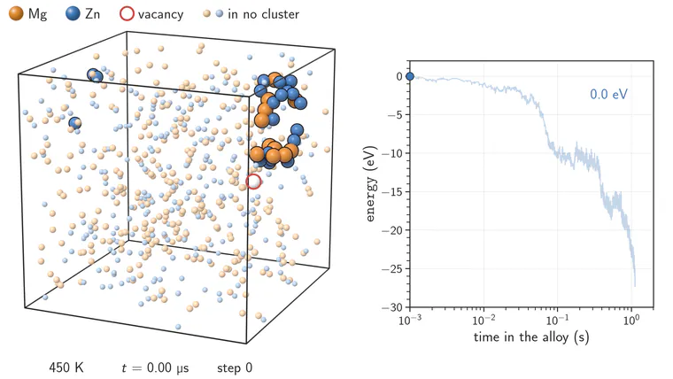

[](https://github.com/zhucongx/LatticeMonteCarlo/actions/workflows/cmake.yml)

# LatticeMC

LatticeMC runs lattice Monte Carlo simulations of substitutional fcc alloys: kinetic Monte Carlo (KMC) of atoms that move by jumps of a vacancy, canonical Monte Carlo (CMC), and simulated annealing (SA). Two further methods work on the files of a run: `Ansys` analyzes the clusters in its configurations, and `Reformat` converts the configurations.

The energy is a cluster expansion, and the barrier of a jump follows from a quartic polynomial for the energy along its path. The coefficients of both come from a JSON file.



*Clusters form in a KMC run of an Al-Mg-Zn alloy at 450 K (Mg orange, Zn blue, Al not shown). [A first run](docs/README.md#a-first-run) shows how it is done.*

## Documentation

The [documentation](docs/README.md) describes how to use the program:

- [Methods](docs/methods.md): what every method does, how it is started, and how fast it is
- [Parameters](docs/parameters.md): every key of the parameter file
- [Input files](docs/input-files.md) and [output files](docs/output-files.md): their formats, and every column of the logs
- [Analysis](docs/analysis.md): clusters, binding energies of vacancies, and escape times
- [Restarting](docs/restart.md): how to continue a run, and how to repeat one
- [Model](docs/model.md): how energies and barriers are computed

## Requirements

- A compiler with C++20 and OpenMP, and CMake 3.14 or later
- Boost (filesystem and iostreams) and MPI. Without MPI the program cannot be built, even if only the methods with one process are used
- Eigen, which is downloaded if it is not installed. nlohmann_json is always downloaded
- Optional: MKL, or another BLAS and LAPACK. MKL is taken if CMake finds it, for oneAPI after `source /opt/intel/oneapi/setvars.sh`

On Ubuntu:

```
sudo apt install build-essential cmake libopenmpi-dev libboost-all-dev libeigen3-dev libblas-dev liblapack-dev
```

On macOS with Homebrew, where `libomp` gives Apple Clang OpenMP:

```
brew install cmake boost open-mpi libomp eigen
```

## Build

```
cmake -S . -B build -DCMAKE_BUILD_TYPE=Release
cmake --build build -j
```

The executable is `bin/lmc.exe` on every platform. `./build.sh r d` does the same in a new directory `cmake-build`. Its first argument is the build type (`r` Release, `d` Debug) and its second one the compiler (`d` default, `g` gcc, `c` clang, `i` icc, `o` icx, `m` mpicc); further arguments are compiler flags.

## Tests

The unit tests need no input files. GoogleTest is downloaded when they are configured. They can be started with `ctest` in the directory `build` as well:

```
cmake -S . -B build -DCMAKE_BUILD_TYPE=Release -DLMC_BUILD_TESTS=ON
cmake --build build -j
bin/lmc_test.exe
```

## Run

```
bin/lmc.exe -p param.txt
```

A run reads a parameter file and the files it names. `script/` has a sample parameter file for every kind of run; the input files that the samples name are not part of the repository. [A first run](docs/README.md#a-first-run) goes through a CMC and a KMC run, and [Methods](docs/methods.md) says which methods are started with `mpirun`.

## Papers

The model and the methods are described in

- Z. Xi, M. Zhang, L. G. Hector Jr., A. Misra, L. Qi, *Mechanism of local lattice distortion effects on vacancy migration barriers in fcc alloys*, Physical Review Materials **6**, 073601 (2022), [doi:10.1103/PhysRevMaterials.6.073601](https://doi.org/10.1103/PhysRevMaterials.6.073601)
- Z. Xi, L. G. Hector Jr., A. Misra, L. Qi, *Kinetic Monte Carlo simulations of solute clustering during quenching and aging of Al–Mg–Zn alloys*, Acta Materialia **269**, 119795 (2024), [doi:10.1016/j.actamat.2024.119795](https://doi.org/10.1016/j.actamat.2024.119795)
- Z. Xi, L. G. Hector Jr., A. Misra, L. Qi, *Multiscale modeling of vacancy-cluster interactions and solute clustering kinetics in multicomponent alloys*, npj Computational Materials **11**, 365 (2025), [doi:10.1038/s41524-025-01840-x](https://doi.org/10.1038/s41524-025-01840-x)

## Layout of the repository

| Directory | Content |
|---|---|
| `lmc/` | The sources: configurations (`cfg`), energies and barriers (`pred`), the simulation methods (`mc`), the analysis (`ansys`), and the parameter file and the start of a run (`api`). The unit tests are in `lmc/<module>/test/` |
| `docs/` | The documentation |
| `script/` | Sample parameter files, and `restart.py`, which prepares the restart of a KMC run |
| `cmake/` | CMake modules |
| `deprecated/` | Old code that is not built |
