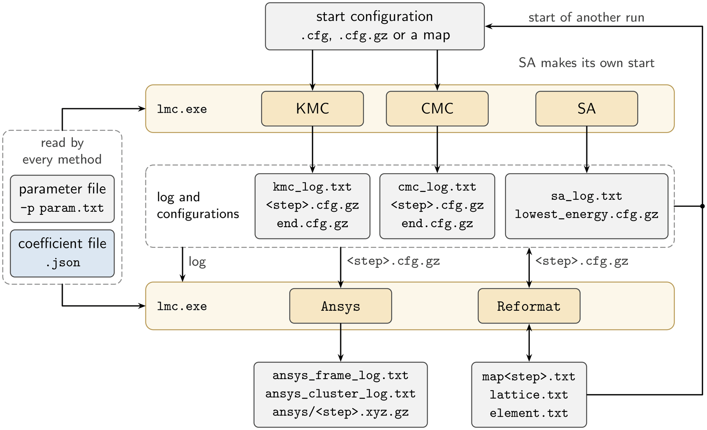
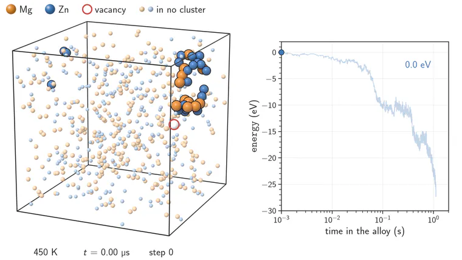

# LatticeMC documentation

LatticeMC runs lattice Monte Carlo simulations of substitutional fcc alloys: kinetic Monte Carlo (KMC) of atoms that move by jumps of a vacancy, canonical Monte Carlo (CMC), and simulated annealing (SA). Two further methods work on the files of a run: `Ansys` analyzes the clusters in its configurations, and `Reformat` converts the configurations.

## Papers

The model and the methods of the program are described in three papers:

1. Z. Xi, M. Zhang, L. G. Hector Jr., A. Misra, L. Qi, *Mechanism of local lattice distortion effects on vacancy migration barriers in fcc alloys*, Physical Review Materials **6**, 073601 (2022), [doi:10.1103/PhysRevMaterials.6.073601](https://doi.org/10.1103/PhysRevMaterials.6.073601)
2. Z. Xi, L. G. Hector Jr., A. Misra, L. Qi, *Kinetic Monte Carlo simulations of solute clustering during quenching and aging of Al–Mg–Zn alloys*, Acta Materialia **269**, 119795 (2024), [doi:10.1016/j.actamat.2024.119795](https://doi.org/10.1016/j.actamat.2024.119795)
3. Z. Xi, L. G. Hector Jr., A. Misra, L. Qi, *Multiscale modeling of vacancy-cluster interactions and solute clustering kinetics in multicomponent alloys*, npj Computational Materials **11**, 365 (2025), [doi:10.1038/s41524-025-01840-x](https://doi.org/10.1038/s41524-025-01840-x)

> [!NOTE]
> This documentation describes how to use the program. For the model, its derivation and its results, please refer to the papers.

## Pages

How to build the program is described in the [project README](../README.md#build).

| Page | What it is about |
|---|---|
| [Methods](methods.md) | The values of `simulation_method`: what each one does, how to start it, and what it writes |
| [Parameters](parameters.md) | The parameter file: its rules, and every key with its unit and default |
| [Input files](input-files.md) | Configurations, coefficient files and time-temperature tables |
| [Output files](output-files.md) | The logs of KMC, CMC and SA, column by column, and the configurations |
| [Analysis](analysis.md) | `Ansys` and `Reformat`: the definition of a cluster, and every column and field they write |
| [Restarting](restart.md) | How to continue a run, and how to repeat one |
| [Model](model.md) | How energies and barriers are computed |

A [tutorial](https://github.com/zhucongx/LatticeMonteCarlo/releases/tag/tutorial) (PDF) explains how the energy is computed and how the simulations run.



*The files of the program. Every method reads a parameter file and a coefficient file, KMC and CMC also a start configuration. `Ansys` and `Reformat` read the log of a run and work on its numbered configurations, and a configuration or a map can be the start of another run.*

## Units

| Quantity | Unit |
|---|---|
| Length, position | Å |
| Energy, barrier | eV |
| Temperature | K |
| Time | s |
| Mass | u |
| Vacancy concentration | vacancies per lattice site |

## A first run

A run needs a directory with a parameter file and the files it names. With this parameter file, `cmc_param.txt`, a CMC run equilibrates the arrangement of the atoms at 800 K, starting from the [configuration](input-files.md#configuration) `start.cfg`:

```
simulation_method CanonicalMcSerial
json_coefficients_filename quartic_coefficients.json
config_filename start.cfg
element_set Al Mg Zn
temperature 800
log_dump_steps 100000
config_dump_steps 1000000
maximum_steps 3000000
seed 12345
```

```
lmc.exe -p cmc_param.txt
```

It writes `cmc_log.txt`, a configuration every 1 000 000 steps, and `end.cfg.gz` at the end. That last configuration can be the start of a KMC run, if it holds exactly one vacancy. Copy it to a new directory as `start.cfg.gz`, because the KMC run writes an `end.cfg.gz` of its own, and start the run there with this parameter file, `kmc_param.txt`:

```
simulation_method KineticMcFirstSerial
json_coefficients_filename quartic_coefficients.json
config_filename start.cfg.gz
element_set Al Mg Zn
temperature 450
log_dump_steps 10000
config_dump_steps 1000000
maximum_steps 10000000
seed 12345
```



*This KMC run, continued to 130 000 000 steps; the number of steps between two pictures grows from 18 000 to almost 8 000 000. Solute atoms in clusters, as [`Ansys`](analysis.md#what-a-cluster-is) finds them with `smallest_cluster_criteria 10`, have their full size (Mg orange, Zn blue), all others are small and pale; the solvent is hidden, and the red ring marks the vacancy, even behind atoms. A cluster that crosses a face of the periodic box continues on the opposite side. The plot shows `energy` from `kmc_log.txt` against the time in an alloy which keeps the vacancies that its solid solution has in equilibrium at 450 K: the 3.5 ms of the run, with one vacancy in 10 976 sites, stand for 1.1 s there (see [Time and vacancy concentration](methods.md#time-and-vacancy-concentration)).*

Start each run in a directory of its own: the names of the output files are fixed, and a new run overwrites the files of the one before.

The program exits with status 0 only if the run completed. An error that the program finds in the input is reported in a line that begins with `Error:`, or with `[rank n] Error:` if there are several MPI processes, and the exit status is not 0.
