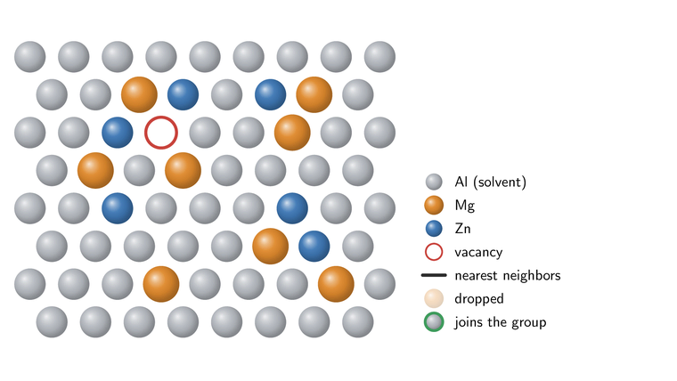
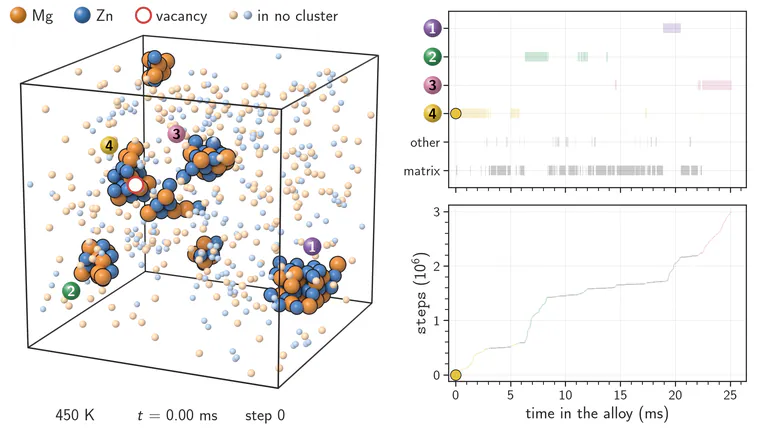
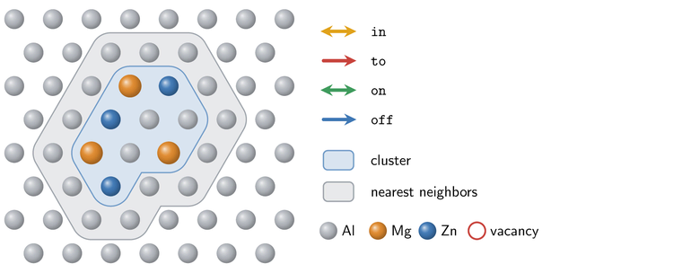
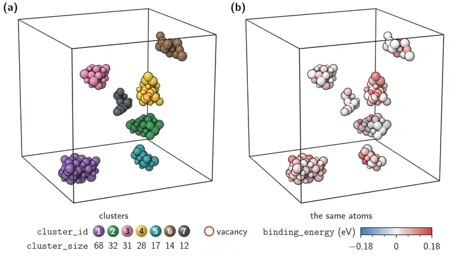

# Analysis

`Ansys` and `Reformat` are started in the directory of a finished run, or of one that is still going on.

## Which frames are read

Both methods read the log of the run: `kmc_log.txt`, `cmc_log.txt` or `sa_log.txt`, as [`log_type`](parameters.md#ansys-and-reformat) selects. They work on the configurations, called frames, at the steps `initial_steps`, `initial_steps + increment_steps`, and so on, up to the last such step that has a row in the log. For every frame they read

- `<step>.cfg.gz` with `config_type config`,
- `map<step>.txt`, `lattice.txt` and `element.txt` with `config_type map`.

`initial_steps` and `increment_steps` are therefore multiples of the `config_dump_steps` of the run. `Ansys` also takes the time, temperature and energy of a frame from the log, so every step it works on needs a [row](output-files.md#when-a-row-is-written) there. If `log_dump_steps` is a power of ten, every multiple of it has one. If it is 250, for example, the steps 1250, 1750 and 2250 have none.

A frame that cannot be read or analyzed is reported, the others are done, and the program ends with an error. The first frame is an exception: if it cannot be read, nothing is done.

SA writes no numbered configurations. To work on its result, copy `lowest_energy.cfg.gz` to `<step>.cfg.gz`, where the step is that of the first row of `sa_log.txt` with the final value of `lowest_energy`, set `initial_steps` to this step, and `increment_steps` to a number above `maximum_steps`. For `Reformat`, use step 0 instead. `Ansys` needs exactly one vacancy in the configuration.

## Ansys

### What a cluster is

1. Solute atoms and vacancies belong together if they are nearest neighbors.
2. A group of fewer than `smallest_cluster_criteria` of them is dropped.
3. A solvent atom joins a group if more than `solvent_bond_criteria` of its twelve nearest neighbors belong to it and are not solvent atoms themselves.

The clusters of a frame are numbered from the largest to the smallest, with the vacancy counted.

*How `Ansys` finds clusters, drawn in two dimensions on a triangular lattice, where a site has 6 nearest neighbors instead of 12, with `smallest_cluster_criteria 4` and `solvent_bond_criteria 2`. The three rules are applied one after the other: solute atoms and vacancies that are nearest neighbors are connected; the groups of fewer than 4 of them are dropped (pale); a solvent atom joins a group if more than 2 of its nearest neighbors are solute atoms or vacancies of the group (green ring). The numbers count these neighbors. At the end the two clusters have their `cluster_id`: cluster 1 has 9 sites with its vacancy, cluster 2 has 5.*

### ansys_frame_log.txt

One row for every frame. Several threads work on different frames, so the rows may be in any order.

| Column | Unit | Meaning |
|---|---|---|
| `steps`, `time`, `temperature`, `energy` | –, s, K, eV | From the log of the run. `time` is `null` if the log has none |
| `num_cluster` | | Number of clusters |
| `num_atom` | | Number of atoms in clusters, without the vacancy |
| `num_<element>` | | Number of atoms of the element in clusters, one column for every element of `element_set` |
| `profile_vacancy_concentration`, `binding_vacancy_concentration`, `profile_simp_vacancy_concentration`, `binding_simp_vacancy_concentration`, `effective_binding_simp_vacancy_concentration` | vacancies per site | Vacancy concentration outside of the clusters, estimated in five ways, see [below](#vacancy-concentrations) |
| `cluster_size_list` | | Sizes of all clusters, as `[14,11,9]` |

### ansys_cluster_log.txt

One row for every cluster of every frame. A value that cannot be computed, such as the shape of a single atom, is written as `null`, and in the barrier columns as `nan`.

| Column | Unit | Meaning |
|---|---|---|
| `steps`, `time`, `temperature`, `energy` | –, s, K, eV | From the log of the run |
| `cluster_id` | | Number of the cluster in its frame, 1 for the largest |
| `cluster_energy` | eV/atom | Formation energy of the cluster per atom: the energy of the cluster in pure solvent, relative to its atoms alone in pure solvent |
| `cluster_size` | | Number of atoms, without the vacancy |
| `neighbor_size` | | Number of sites that are nearest neighbors of the cluster and do not belong to it |
| `cluster_<element>` | | Number of atoms of the element, one column for every element of `element_set` |
| `cluster_X` | | Number of vacancies in the cluster |
| `effective_radius` | Å | Radius of a sphere with the volume of the sites of the cluster, a³/4 each, with a = 4.046 Å |
| `mass_gyration_radius` | Å | Radius of gyration: the square root of the sum of the eigenvalues λ₁ ≤ λ₂ ≤ λ₃ of the mass-weighted gyration tensor |
| `asphericity` | Ų | λ₃ − (λ₁ + λ₂)/2 |
| `acylindricity` | Ų | λ₂ − λ₁ |
| `anisotropy` | | Relative shape anisotropy, between 0 (sphere) and 1 (line): (3/2) (λ₁² + λ₂² + λ₃²) / (λ₁ + λ₂ + λ₃)² − 1/2 |
| `markov_escape_time` | s | Mean time a vacancy needs to leave the cluster and its nearest neighbor sites at `escape_temperature`, see [below](#escape-of-a-vacancy) |
| `effective_binding_energy` | eV | Binding energy that corresponds to this time |
| `vacancy_profile_energy` | eV | Lowest `profile_energy` of the sites of the cluster |
| `vacancy_binding_energy` | eV | Lowest `binding_energy` of the sites of the cluster |
| `vacancy_binding_energy_<element>` | eV | Lowest `binding_energy_<element>` of the sites of the cluster, one column for every element of `element_set` |
| `barrier_mean_in`, `barrier_mean_to`, `barrier_mean_on`, `barrier_mean_off` | eV | Mean barriers around the cluster, see [below](#barriers-around-a-cluster) |
| `barrier_std_in`, `barrier_std_to`, `barrier_std_on`, `barrier_std_off` | eV | Standard deviations of the same barriers |
| `geometry_center` | Å | Center of the cluster, as `[x,y,z]` |

The `geometry_center` of a cluster is found from the circular mean of the angles 2π*x*, where *x* is the position of a site of the cluster relative to the box. This takes care of the periodic boundaries, and differs a little from the mean of the positions. The shape is computed around the `mass_center` of the xyz file, which is the same mean weighted by the masses.

### Binding energies of a site

For every site the analysis asks what it costs to put a vacancy there: the energy change when a vacancy in pure solvent and the atom on the site change places. A negative value means that the site attracts the vacancy. The vacancy of the frame itself is replaced by a solvent atom first.

- `profile_energy`: the vacancy replaces the atom that is there. For the site of the vacancy of the frame, the largest value over the elements that could be there.
- `binding_energy_<element>`: the vacancy replaces an atom of this element, whatever is there.
- `binding_energy`: the largest of the `binding_energy_<element>`.

### Vacancy concentrations

Each of these columns is the concentration $c$ of vacancies in the box, times the share of the time a vacancy would spend outside of the clusters at the temperature of the frame:

$$c_{\mathrm{outside}} = c \frac{\sum_{i\ \text{outside}} \exp(-E_i/k_B T)}{\sum_{i} \exp(-E_i/k_B T)}.$$

For an alloy with another [vacancy concentration](methods.md#time-and-vacancy-concentration), multiply the columns by $c_{\mathrm{alloy}} / c$. Every site that is in no cluster counts as outside, even next to a cluster or a solute atom. The columns differ in the energy $E_i$ of a site; [Xi et al. 2025](model.md#papers) use an effective binding energy of the clusters, as in the last row:

| Column | Energy of a site |
|---|---|
| `profile_vacancy_concentration` | Its `profile_energy` |
| `binding_vacancy_concentration` | Its `binding_energy` |
| `profile_simp_vacancy_concentration` | `vacancy_profile_energy` of its cluster, 0 outside |
| `binding_simp_vacancy_concentration` | `vacancy_binding_energy` of its cluster, 0 outside |
| `effective_binding_simp_vacancy_concentration` | `effective_binding_energy` of its cluster, 0 outside |

### Escape of a vacancy

`markov_escape_time` is computed with a Markov chain. The vacancy starts in thermal equilibrium on the sites of the cluster and their nearest neighbor sites, with `profile_energy` as the energy of a site. It jumps with the rates of [KMC](methods.md#kinetic-monte-carlo) until it leaves these sites. The temperature is `escape_temperature`, not that of the frame. `effective_binding_energy` is the energy for which a simple barrier gives the same time:

$$E = -k_B T_{\mathrm{escape}} \ln(\nu t_{\mathrm{escape}}) + E_{\mathrm{off}},$$

with $E_{\mathrm{off}}$ from the column `barrier_mean_off`.

The time comes from the inverse of a matrix, and its last digits depend on the order of the sums. If you compare two analyses of the same frame, allow a relative difference of 10⁻⁴ in `markov_escape_time`, `effective_binding_energy` and `effective_binding_simp_vacancy_concentration` at an `escape_temperature` of 300 K or more. At lower temperatures more digits are lost, and at 200 K and below the time can be wrong, or even negative.

*A KMC run at 450 K with `log_dump_steps 1` that starts from the last configuration of the KMC run of [A first run](README.md#a-first-run): 3 000 000 steps. Left: solute atoms in clusters at full size (Mg orange, Zn blue), all others small and pale, the solvent hidden; the white disk with the red ring is the vacancy, and the red line its path during the last five pictures. Right: where the vacancy is, and the column `steps` of `kmc_log.txt` against the time, in the color of that place. The vacancy is at a cluster while it is on a site of the cluster or on a nearest neighbor site of one, the sites that `markov_escape_time` refers to; everywhere else it is in the matrix. The clusters are found in the configuration of every step, as [`Ansys`](#what-a-cluster-is) finds them with `smallest_cluster_criteria 10` and `solvent_bond_criteria 3`; the four largest keep the `cluster_id` and the color of the [frame below](#ansysstepxyzgz), which is the start of this run, and the smaller ones share the row "other". The vacancy makes 96.7 % of its steps at clusters, in 52 % of the time; the 3.3 % of the steps in the matrix take the other 48 %. Times are those of an alloy which keeps the vacancies that its solid solution has in equilibrium at 450 K, as in the animation of [A first run](README.md#a-first-run): the 77 µs of the run, with one vacancy in 10 976 sites, stand for 25 ms (see [Time and vacancy concentration](methods.md#time-and-vacancy-concentration)). The pictures are equally spaced in the time of the run.*

### Barriers around a cluster

The barrier of a jump is taken as $E_a - \Delta E/2$, which is the same for the jump back. The four groups of jumps are:

| Group | Jumps of the vacancy |
|---|---|
| `in` | between two sites of the cluster |
| `to` | from a site of the cluster to a nearest neighbor site outside |
| `on` | between two sites outside that are both nearest neighbors of the cluster |
| `off` | from such a site to one that is not a nearest neighbor of the cluster |

*The four groups of jumps, drawn in two dimensions around cluster 1 of the animation that shows how clusters are found; its vacancy is replaced by a solvent atom first. For every jump `Ansys` puts a vacancy on the first site in place of the atom there; the animation shows two such jumps of each group and puts the atoms back after each. An arrow is a jump of the vacancy from the tail to the head of the arrow, and a double arrow stands for both directions.*

### ansys/&lt;step&gt;.xyz.gz

One file for every frame in the extended XYZ format, which OVITO reads. The comment line has the steps, time, temperature and energy of the frame. The fields of an atom are:

| Field | Unit | Meaning |
|---|---|---|
| `species`, `pos` | –, Å | Element and Cartesian position |
| `map_shift` | | Counts of the boundary crossings in each direction |
| `cluster_id`, `cluster_size` | | Number and size of its cluster, 0 for an atom that is in none |
| `cluster_<element>`, `cluster_X` | | Number of atoms of the element, and of vacancies, in its cluster, 0 for an atom that is in none |
| `cluster_mass` | u | Mass of its cluster |
| `cluster_energy`, `effective_radius`, `mass_gyration_radius` | eV/atom, Å, Å | As in the cluster log |
| `cluster_asphericity`, `cluster_acylindricity`, `cluster_anisotropy` | Ų, Ų, – | As `asphericity`, `acylindricity` and `anisotropy` in the cluster log |
| `geometry_center`, `mass_center` | Å | Center and center of mass of its cluster |
| `profile_energy`, `binding_energy`, `binding_energy_<element>` | eV | [Binding energies](#binding-energies-of-a-site) of its site |

The other fields of a cluster are `nan` for an atom that is in none. A frame without any cluster has none of the fields of a cluster except `cluster_<element>`.

*One frame of `Ansys` with `smallest_cluster_criteria 10` and `solvent_bond_criteria 3` in a full turn: step 10 000 000 of the KMC run of [A first run](README.md#a-first-run). Both panels show the atoms of the seven clusters, the solvent atoms that joined them drawn smaller: (a) in the color of their `cluster_id`, with `cluster_size` below it; (b) colored by `binding_energy`: a site with a negative value (blue) attracts a vacancy, one with a positive value (red) repels it. The red ring marks the vacancy, which is inside cluster 4, even behind atoms. Atoms that are in no cluster are not drawn, neither the other 437 solute atoms nor the solvent around them. The periodic box is shifted so that no cluster is cut by a face.*

## Reformat

Converts between the two kinds of [configuration](input-files.md), in the direction that `config_type` gives for the input:

| `config_type` | Reads | Writes |
|---|---|---|
| `config` | `<step>.cfg.gz` | `map<step>.txt`, and for step 0 also `lattice.txt` and `element.txt` |
| `map` | `lattice.txt`, `element.txt`, `map<step>.txt` | `<step>.cfg.gz` |

A map does not hold the counts of the boundary crossings, so they are lost on the way. With `config_type config`, start at step 0, so that `lattice.txt` and `element.txt` are written.
