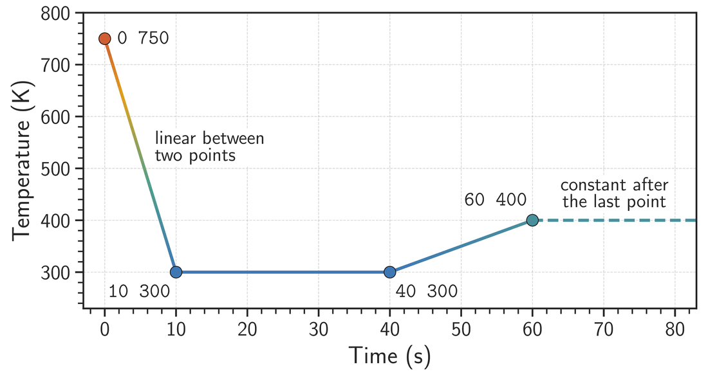

# Input files

## Configuration

`config_filename` names a file in the extended CFG format, which OVITO and AtomEye read as well. A file whose name ends with `.gz` is compressed. SA makes its own start configuration. For CMC and KMC it comes from another run or from another program: ASE, for example, writes one with `ase.io.write("start.cfg", atoms)`, where the vacancy has the symbol `X`.

```
Number of particles = 10976
A = 1.0 Angstrom (basic length-scale)
H0(1,1) = 56.644 A
H0(1,2) = 0 A
H0(1,3) = 0 A
H0(2,1) = 0 A
H0(2,2) = 56.644 A
H0(2,3) = 0 A
H0(3,1) = 0 A
H0(3,2) = 0 A
H0(3,3) = 56.644 A
.NO_VELOCITY.
entry_count = 6
auxiliary[0] = ix
auxiliary[1] = iy
auxiliary[2] = iz
0
X
0.2142857142857143 0.5 0.2142857142857143 0 0 0
26.98
Al
0.9285714285714285 0.8928571428571428 0.8928571428571428 0 0 0
```

- The rows of `H0` are the vectors of the box, in Å.
- Three lines follow for every atom: its mass, its element, and its position relative to the box vectors.
- The three whole numbers after the position count how often the atom has crossed the boundaries of the box in each direction. They are optional: with `entry_count = 3` the line ends after the position, and the counts start at 0. Further entries of a line are ignored.
- `X` is the vacancy. The other elements the program knows are listed in `lmc/cfg/include/Element.hpp`; a new one is one new line there.
- The masses of the file are not used.

What the program requires of a configuration:

- Every atom sits exactly on a site of an fcc lattice (give the positions with at least six decimal places), and every site holds an atom or a vacancy. A relaxed structure cannot be used. CMC checks neither this nor the lattice constant, and goes on with wrong energies.
- The lattice constant is that of aluminum, about 4.05 Å. The neighbor shells are found by fixed cutoff distances of 3.5, 4.8 and 5.3 Å.
- For KMC, `Ansys` and `Reformat` the box is a cube with its edges along x, y and z, each 4 to 49 unit cells long. A smaller box, or one that is no such cube, is refused with a message that names it, a larger one with `The clusters of a group of the one-hot cluster mapping differ in kind`. CMC only needs three unit cells in every direction.
- KMC and `Ansys` need exactly one vacancy, CMC at most one. The model has no terms for two vacancies near each other: a run in which they meet stops with `Cluster not found in ClusterIndexer`.
- All its elements except `X` are in `element_set`.

## Lattice, element and map

A run can also start from three text files. `Reformat` writes them.

| File | Content |
|---|---|
| `lattice.txt` | Number of sites; the three box vectors; and one line for every site: its relative position, `#`, and the numbers of its 12 first, 6 second and 24 third neighbors |
| `element.txt` | One line for every atom: its element |
| The file named by `map_filename` | One line for every atom: the number of its site, counted from 0 in the order of `lattice.txt` |

The first two names are fixed. These files do not hold the counts of the boundary crossings, so they start at 0.

## Coefficient file

`json_coefficients_filename` names a JSON file with the coefficients of the [model](model.md). It has one entry `Base` for the energies and one entry for every element, named by its symbol, for the barriers:

| Entry | Content |
|---|---|
| `Base.theta` | Coefficients of the clusters |
| `mu_x_mmm`, `sigma_x_mmm` | Mean and scale of the encoding of the neighborhood, for the distance |
| `U_mmm` | Projection of the scaled encoding, one row for every component |
| `theta_D`, `mu_D`, `sigma_D` | Coefficients of the components, and mean and scale of the logarithm of the distance |
| `mu_x_mm2`, `sigma_x_mm2`, `U_mm2`, `theta_Ks`, `mu_Ks`, `sigma_Ks` | The same for the sum of the curvatures |

The sizes follow from the elements of `element_set`, in SA from `solvent_element` and `solute_element_set`. With three elements, `Base.theta` has 95 entries, and the encodings have 711 and 1401. A file whose sizes do not fit is rejected, with a message that names the entry and the size it should have. CMC and SA use `Base` only.

## Time-temperature table

`time_temperature_filename` names a text file with a time in s and a temperature in K on every line:

```
# quench and aging
0    750
10   300
40   300
60   400
```



*Temperature that this table gives; the labels at the points are the lines of the file. Between two points it is interpolated linearly, and after the last point it stays constant (dashed).*

- A line that does not begin with two numbers is ignored.
- The points need not be in order. Between two points the temperature is interpolated linearly, and before the first and after the last point it is constant.
- A temperature that is not above 0, and two points with the same time, are errors.
- The time is that of the log, a time of the run. For the time in an alloy see [Time and vacancy concentration](methods.md#time-and-vacancy-concentration).
