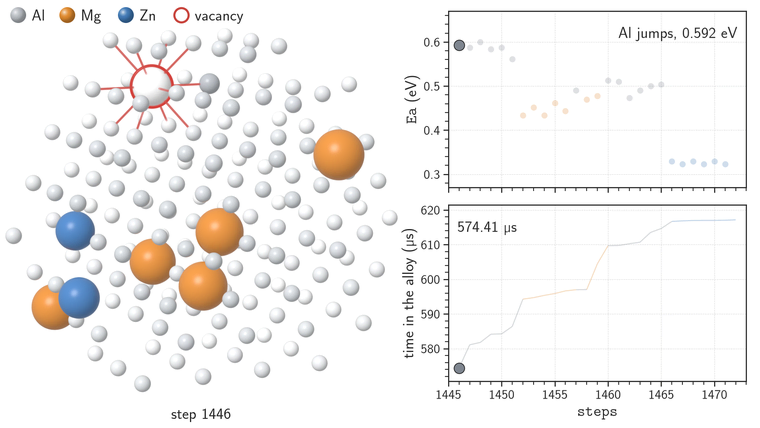
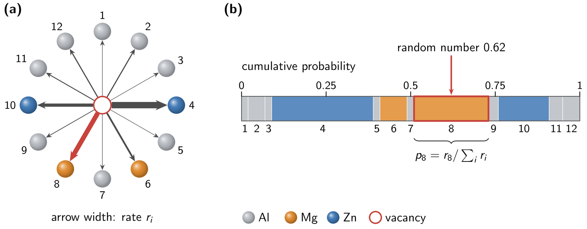
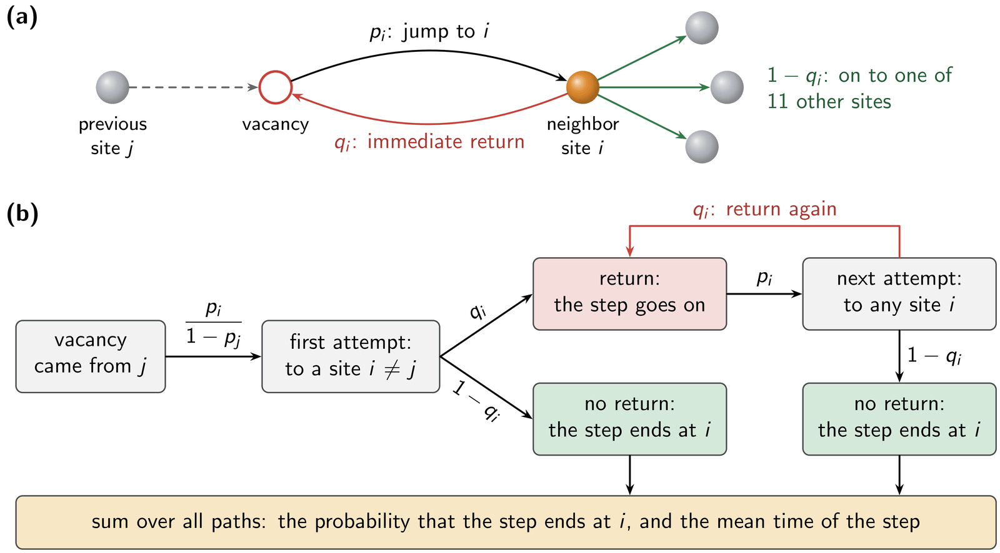
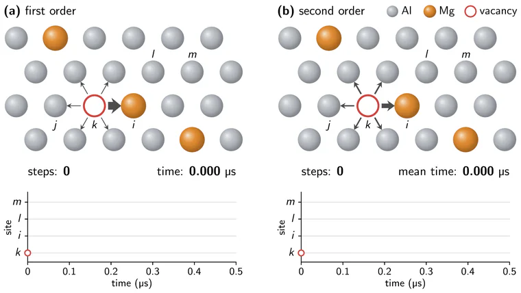
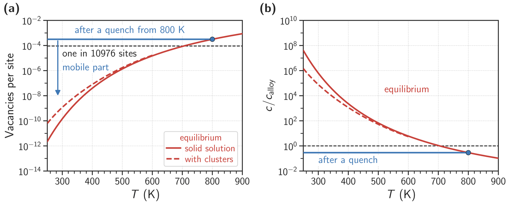
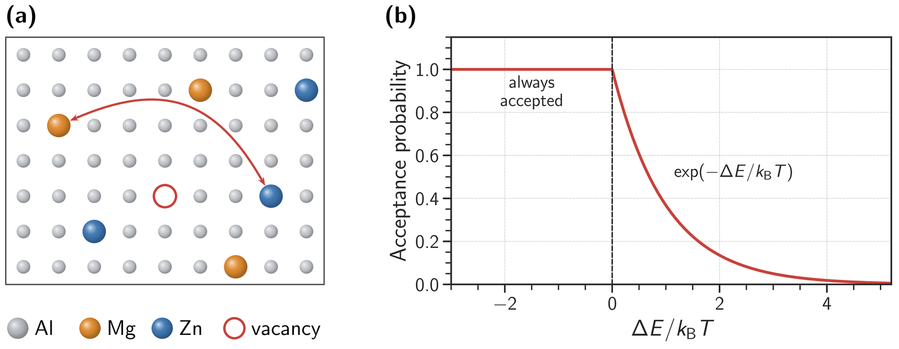
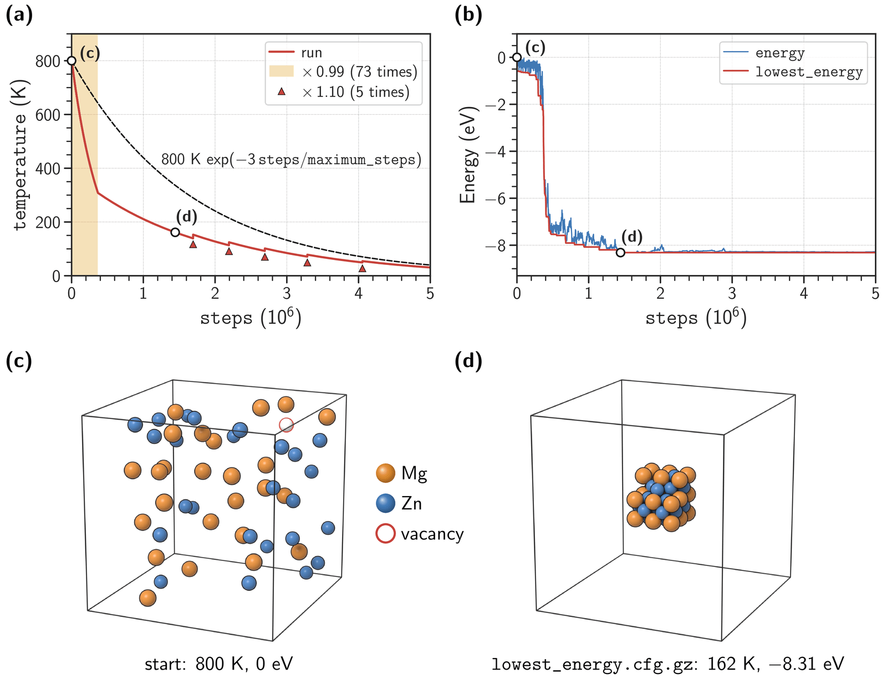
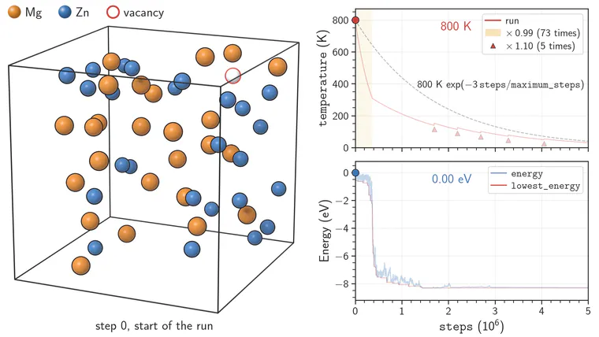

# Methods

The key `simulation_method` of the [parameter file](parameters.md) selects what the program does.

| `simulation_method` | What it does | MPI processes | OpenMP threads |
|---|---|---|---|
| [`KineticMcFirstSerial`](#kineticmcfirstserial-and-kineticmcfirstmpi) | KMC, first order | 1 | at start-up only |
| [`KineticMcFirstMpi`](#kineticmcfirstserial-and-kineticmcfirstmpi) | KMC, first order | 12 | at start-up only |
| [`KineticMcChainOmpi`](#kineticmcchainompi) | KMC, second order | 12 | yes |
| [`CanonicalMcSerial`](#canonicalmcserial-and-canonicalmcomp) | CMC | 1 | at start-up only |
| [`CanonicalMcOmp`](#canonicalmcserial-and-canonicalmcomp) | CMC | 1 | yes |
| [`SimulatedAnnealing`](#simulatedannealing) | SA | 1 | at start-up only |
| [`Ansys`](analysis.md) | Analysis of the configurations of a run | 1 | yes |
| [`Reformat`](analysis.md#reformat) | Conversion of the configurations of a run | 1 | yes |

A method that is started with another number of MPI processes stops with a message. The number of threads is set with `OMP_NUM_THREADS`.

```
lmc.exe -p param.txt                                          # the methods with one process
mpirun -np 12 lmc.exe -p param.txt                            # KineticMcFirstMpi
OMP_NUM_THREADS=1 mpirun -np 12 lmc.exe -p param.txt          # KineticMcChainOmpi
```

With one process a step takes a few microseconds, which is less than it costs to start a group of threads or to exchange messages between processes. The [project README](../README.md#run) has a table of the speeds. Spare cores are usually better spent on independent runs.

## Kinetic Monte Carlo

The configuration must hold exactly one vacancy, the element `X`. Atoms move by jumps of this vacancy to one of its twelve nearest neighbor sites. The rate of a jump is

$$r = \nu \exp\left(-\frac{E_a}{k_B T}\right), \qquad \nu = 10^{13}\ \mathrm{s}^{-1},$$

with the barrier $E_a$ of the [model](model.md). The three methods write [`kmc_log.txt`](output-files.md#kmc_logtxt) and [configurations](output-files.md#configurations).



*Steps 1446 to 1471 of the KMC run of [A first run](README.md#a-first-run), repeated with `log_dump_steps 1` to get a row of the log for every step, and seen close to the vacancy. Al atoms are drawn small, and the one that jumps is marked dark gray. Thin red lines join the vacancy with its twelve nearest neighbors, and the thick red line is its path over the last seven jumps. The panels show the columns `Ea` and `time` of `kmc_log.txt`, colored by the element that jumps: the last six jumps, back and forth with a Zn atom, take only 1 % of the 131 ns.*

### KineticMcFirstSerial and KineticMcFirstMpi

First-order residence time algorithm. In every step one of the twelve jumps is drawn with a probability proportional to its rate, and the time advances by $-\ln(u)/\sum_i r_i$, where $u$ is a random number between 0 and 1.

`KineticMcFirstMpi` does the same with twelve processes, one for each jump.



*One step of first-order KMC. (a) The vacancy and its twelve jumps, drawn in a ring; the width of an arrow is proportional to the rate rᵢ of the jump. (b) The probabilities pᵢ = rᵢ / Σ rᵢ of the jumps fill the interval from 0 to 1, and the jump whose segment contains a random number is made, here jump 8 (the numbers are an example).*

### KineticMcChainOmpi

Second-order residence time algorithm. At low temperature the vacancy often jumps back and forth between two sites. This method treats such returns analytically. It takes the rates of the twelve jumps of the vacancy and of the twelve jumps that can follow each of them. From these it finds, for every neighbor site, the probability that the vacancy ends up there after its immediate returns. The time advances by the mean time until then, taken over all these sites, without a random number. One step therefore covers many single jumps where the vacancy is trapped, and it takes longer to compute, because it needs 144 barriers instead of 12. The first jump of a step does not lead back to the site the vacancy came from, because the step before has already counted such returns.



*One step of second-order KMC. (a) The probabilities pᵢ of a jump to the neighbor site i and qᵢ of an immediate return from there. (b) The paths the vacancy can take. The site where the step ends is drawn with the probabilities summed over all paths, and the time advances by the mean time of the step.*



*A vacancy that flickers between two sites, in first-order (a) and second-order KMC (b), sketched in two dimensions with 6 neighbor sites instead of 12. It has just come from site j to site k, and it exchanges places with a Mg atom 100 times faster than with an Al atom. In (a) every jump is a step and takes a random time, and the vacancy makes 21 steps between k and i before it moves on. In (b) one step takes it to i, the site it ends up on after its immediate returns to k, and the clock advances by the mean time until then. The arrow widths show the probabilities of the next jump (a) and of the site on which the step ends (b), and the lower panels show the site of the vacancy against time. The random numbers were chosen so that both runs take the same way.*

### Time and vacancy concentration

The box holds one vacancy in $N$ sites at every temperature: its vacancy concentration is $c = 1/N$. That of an alloy is different, and its atoms move faster or slower in proportion to it. A time $t$ of the run therefore stands for the time $t c / c_{\mathrm{alloy}}$ in an alloy with $c_{\mathrm{alloy}}$ vacancies per site. Both numbers count all vacancies, free or bound: the vacancy of the run, too, spends a part of its time at solute atoms and in clusters.

The program does not convert the time, because $c_{\mathrm{alloy}}$ depends on the history of the alloy (Xi et al. 2025, see [Papers](model.md#papers)).

**In equilibrium** at the temperature $T$ it is the sum of the vacancies in the matrix, next to single solute atoms, and in or next to clusters. This is about

$$c_{\mathrm{alloy}}(T) = c_{\mathrm{Al}}(T) \frac{1}{N} \sum_i \exp\left(-\frac{E_i}{k_B T}\right), \qquad c_{\mathrm{Al}}(T) = 1.67 \exp\left(0.7 - \frac{0.66\ \mathrm{eV}}{k_B T}\right),$$

where the sum is over all sites, $E_i$ is the [`profile_energy`](analysis.md#binding-energies-of-a-site) that `Ansys` writes for a site, and $c_{\mathrm{Al}}$ is the concentration in pure aluminum.

**After a quench** it stays what it was at the temperature of the solution treatment until the surplus has disappeared. At room temperature and far from grain boundaries this takes hours to days, at a higher temperature less. For that time the factor $c / c_{\mathrm{alloy}}$ is a constant. As clusters grow they trap most of these vacancies, and the mobile part, which [`Ansys`](analysis.md#vacancy-concentrations) estimates, can fall by orders of magnitude, but that is part of the simulation: its vacancy is trapped in the same way.

The times of a [time-temperature table](input-files.md#time-temperature-table) are times of the run as well. For a quench, divide those of the cooling curve by the constant factor.



*Vacancy concentrations for the KMC run of [A first run](README.md#a-first-run), with 10976 sites. (a) Vacancies per site: in equilibrium, with the sites of the start configuration, a solid solution (red), and with those of the last one, in which clusters have formed (red, dashed); after a quench from 800 K (blue, about 3 × 10⁻⁴), where the mobile part falls as clusters trap vacancies (arrow, not to scale); and in the box (black, dashed). (b) The factor that turns the time of the run into the time in the alloy, in the same colors. After the quench it is about 0.3; in equilibrium at the 450 K of the run it is about 330 at the start and 220 at the end.*

### Early stop

With `early_stop true` the run ends when all 42 sites of the first three neighbor shells of the vacancy hold solvent atoms, the solvent being the most frequent element. It then writes `escaped.cfg.gz` instead of `end.cfg.gz`, and prints the time as `t_exit` and the number of steps.

### Displacement of the solutes

With `solute_disp true` the log gets three more columns: the displacement of the center of mass of all solute atoms since the start of the run. It starts at zero again after a restart.

## Canonical Monte Carlo

### CanonicalMcSerial and CanonicalMcOmp

Metropolis algorithm at a constant temperature and composition. A step draws two sites of the whole box that hold different elements, one of which may be the vacancy, and exchanges them if that lowers the energy, or else with the probability $\exp(-\Delta E / k_B T)$. Both methods write [`cmc_log.txt`](output-files.md#cmc_logtxt) and [configurations](output-files.md#configurations).



*One step of CMC, or of SA at its current temperature. (a) Two sites anywhere in the box that hold different elements are drawn for an exchange; one of them may be the vacancy. (b) The exchange is made if it lowers the energy, or else with the probability exp(−ΔE/k<sub>B</sub>T).*

`CanonicalMcOmp` evaluates several pairs at a time, one per thread. No site of a pair may be within the third neighbor shell of a site of another pair, so the energy changes do not depend on each other. The run depends on the number of threads. With $n$ threads it may go up to $n - 1$ steps beyond `maximum_steps`.

## SimulatedAnnealing

Search for a configuration of low energy. The method makes its own start configuration: a box of `factor`³ unit cells of the solvent with the solutes on random sites. As long as there is room, no two solutes are first, second or third neighbors of each other. From there on it makes the steps of CMC while the temperature falls:

- In every step the temperature is multiplied by exp(−3 / `maximum_steps`), which takes it to 5 % of `initial_temperature` over the whole run.
- Every 0.1 % of `maximum_steps` the share of accepted steps is looked at. If it is above 50 %, the temperature is multiplied by 0.99.
- At most five times in a run the temperature is multiplied by 1.10. Three things must hold for this: the last such reheating (or the start) is at least 10 % of `maximum_steps` ago, the lowest energy since then was found at least 5 % of `maximum_steps` ago, and fewer than 5 % of the steps since the last look were accepted.

The method writes [`sa_log.txt`](output-files.md#sa_logtxt) and `lowest_energy.cfg.gz`, the configuration with the lowest energy so far. A minimum counts as new if it is lower by more than 10⁻⁴ eV. The method writes no other configuration, and it cannot be restarted. With one vacancy among the solutes and a `factor` from 4 to 49, the result can be the start configuration of a KMC run.

This parameter file looks for the best arrangement of 25 Mg atoms, 25 Zn atoms and a vacancy in a box of 4000 sites:

```
simulation_method SimulatedAnnealing
json_coefficients_filename quartic_coefficients.json
factor 10
solvent_element Al
solute_element_set Mg Zn X
solute_number_set 25 25 1
log_dump_steps 1000
maximum_steps 5000000
initial_temperature 800
seed 12345
```



*Simulated annealing with this file. (a) The temperature was multiplied by 0.99 every 5000 steps up to step 365 000, where more than 50 % of the steps were accepted (shaded), and by 1.10 five times later (triangles); the dashed line is the schedule without these factors. (b) The columns `energy` and `lowest_energy` of `sa_log.txt`; 0 eV stands for a solid solution of single solute atoms, like the start. (c) The start, which the method makes itself and does not write to a file, and (d) `lowest_energy.cfg.gz`, found at step 1 443 971, both without the Al atoms; in (d) the vacancy is hidden inside the cluster.*



*The same run as an animation, slowed down while the cluster forms. The last picture is `lowest_energy.cfg.gz`. SA writes no other configuration; the ones before it come from a modified build that also writes numbered configurations.*
