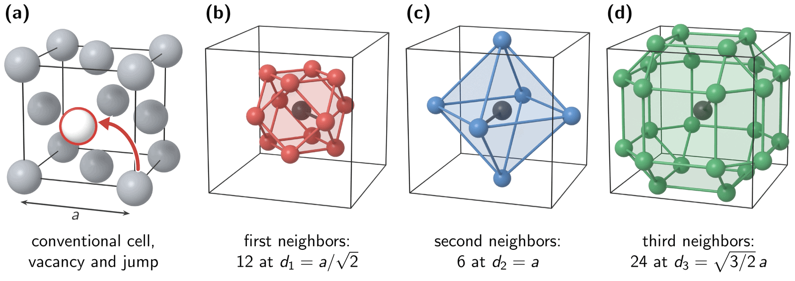
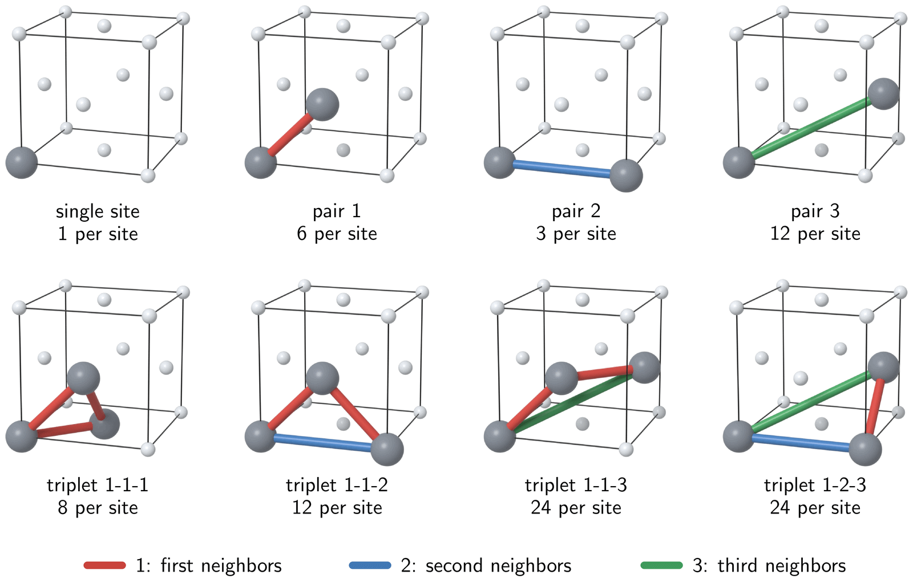
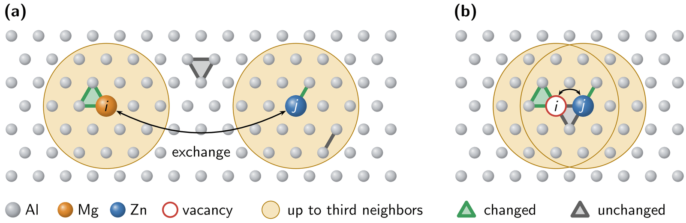
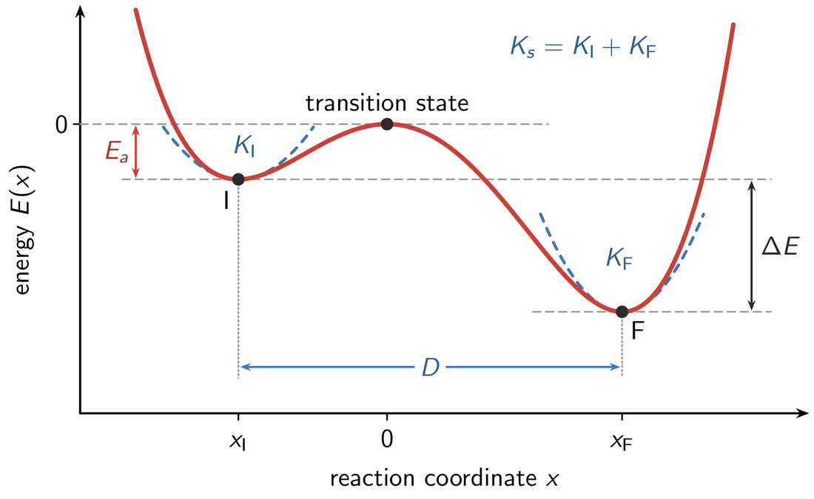
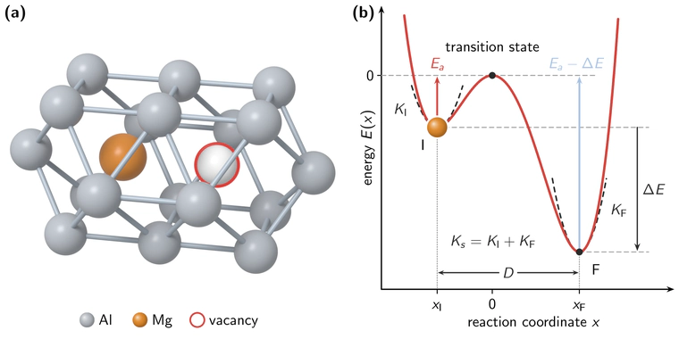
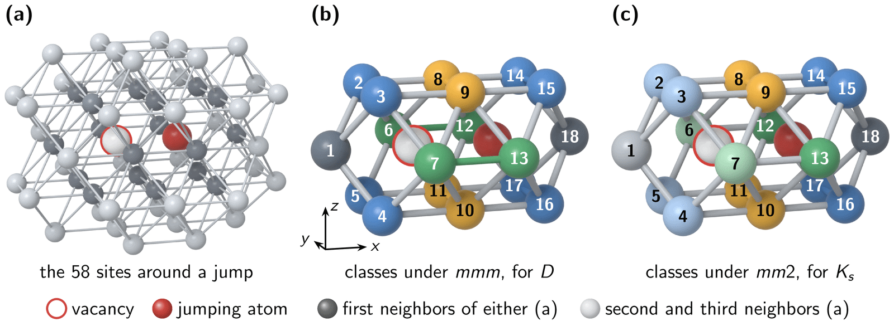
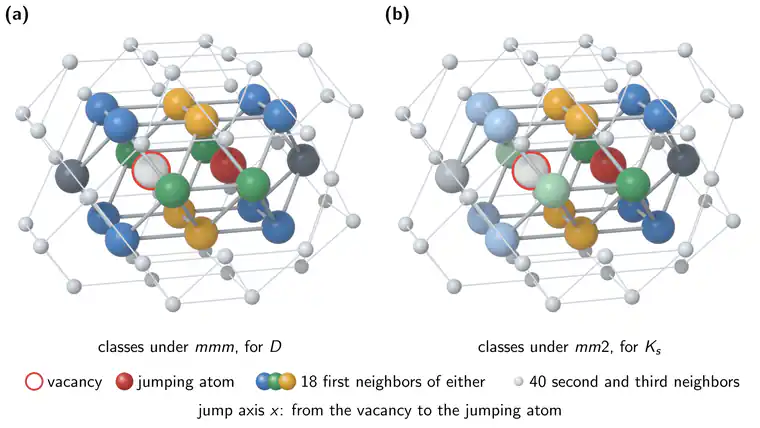

# Model

This page is a short description of the model the program evaluates. The papers at the end explain where it comes from.

## Lattice

Atoms and vacancies sit on the sites of an fcc lattice. A site has 12 first, 6 second and 24 third neighbors, found by the cutoff distances 3.5, 4.8 and 5.3 Å. The boundaries are periodic. Sites do not move: the relaxation of the atoms is part of the coefficients.

*The fcc lattice. (a) The conventional cell with the lattice constant a, a vacancy (white with a red ring) and one of the twelve jumps that can fill it. (b) to (d) The first, second and third neighbors of the dark site in the middle; the black boxes are two lattice constants wide.*

## Energy

The energy of a configuration is a cluster expansion,

$$E = \sum_{\alpha} \theta_\alpha \frac{n_\alpha}{N_\alpha},$$

where $n_\alpha$ is the number of clusters of kind $\alpha$ in the box, $N_\alpha$ the number of all clusters of the same shape in a box of 256 sites, and $\theta_\alpha$ a coefficient of the [coefficient file](input-files.md#coefficient-file). A kind is a shape together with the elements on its sites, no matter which site holds which. The vacancy counts as an element, and a kind holds at most one. There are eight shapes:

| Shape | Distances |
|---|---|
| Single site | |
| Pairs | first, second or third neighbors |
| Triplets | 1-1-1, 1-1-2, 1-1-3 and 1-2-3: the shells of the three distances |

*The eight cluster shapes of the energy model. The digits in a name are the neighbor shells of the distances between its sites, which the colors show as well. The number below a name says how many such clusters there are per site of the crystal; 256 times this number is Nα.*

CMC, SA and KMC do not need the energy itself but its change when two sites exchange their atoms, $\Delta E$, which only depends on the clusters around these two sites.

*Which clusters of the cluster expansion change when the sites i and j exchange their atoms, drawn on a triangular lattice: only those that hold exactly one of the two sites (green), and these lie within the third neighbor shell of this site (circles). (a) Two distant sites; (b) a jump of the vacancy to a nearest neighbor site. Clusters that hold both sites have the same elements after the exchange and do not change.*

## Barrier

The energy along the path of a jump is described by a quartic polynomial $E(x) = a x^4 + b x^3 + c x^2$ with the transition state at $x = 0$. Three quantities fix it:

- the energy change $\Delta E$ of the jump, from the cluster expansion,
- the distance $D$ between the two minima, measured along the path,
- the sum $K_s$ of the curvatures at these minima.

*Energy along the path of a jump from I to F, with the barrier Ea, the energy change ΔE (negative here) and the distance D between the two minima. The dashed parabolas have the curvatures KI and KF of the energy at the minima, and Ks is the sum of the two.*

*A Mg atom jumps into the vacancy and back. (a) The atom and the 18 first neighbors of the two sites; this is a sketch, because the program works on rigid sites and does not follow the atom on its way. (b) An example of the energy along the path, with a ball that moves with the atom: the jump from I over the transition state to F has the barrier Ea, the jump back has the barrier Ea − ΔE, and ΔE is negative here.*

The logarithms of $D$ and $K_s$ depend on the elements on the 58 other sites that lie within the third neighbor shell of one of the two sites of the jump. They are linear functions of the elements on these sites, and on pairs of these sites that are first, second or third neighbors of each other, averaged over the sites and pairs that are equivalent. Which sites are equivalent follows from the symmetry of the two sites of the jump (mmm) for $D$, and from that of the two sites with a direction (mm2) for $K_s$, where the averages seen along the jump and against it are added. Two pairs are equivalent if they belong to the same shell and the sites of one are equivalent to those of the other. The coefficients depend on the element that jumps.

*The surroundings of a jump in the barrier model. (a) The 58 sites within the third neighbor shell of the vacancy or of the jumping atom. (b, c) The 18 of them that are first neighbors of the vacancy or of the jumping atom, numbered to tell them apart: sites of the same color are equivalent, in four classes under mmm and in seven under mm2, which tells the two ends of the jump axis x apart.*

*The 58 sites of (a) in a full turn, with the vacancy (white with a red ring) and the jumping atom (red) in the middle. The 18 first neighbors are large, in the colors of (b); the other 40 sites, which are second or third neighbors of the vacancy or of the jumping atom, are small and pale.*

The barrier follows from the three quantities as

$$E_a = \frac{K_s D^2}{64} \left(1 + \frac{3u}{4}\right)^3 \left(1 - \frac{u}{4}\right), \qquad u = \frac{16 \Delta E}{K_s D^2}.$$

The barrier of the jump back is $E_a - \Delta E$, so the rates satisfy detailed balance.

## Papers

- Z. Xi, M. Zhang, L. G. Hector Jr., A. Misra, L. Qi, *Mechanism of local lattice distortion effects on vacancy migration barriers in fcc alloys*, Physical Review Materials **6**, 073601 (2022), [doi:10.1103/PhysRevMaterials.6.073601](https://doi.org/10.1103/PhysRevMaterials.6.073601)
- Z. Xi, L. G. Hector Jr., A. Misra, L. Qi, *Kinetic Monte Carlo simulations of solute clustering during quenching and aging of Al–Mg–Zn alloys*, Acta Materialia **269**, 119795 (2024), [doi:10.1016/j.actamat.2024.119795](https://doi.org/10.1016/j.actamat.2024.119795)
- Z. Xi, L. G. Hector Jr., A. Misra, L. Qi, *Multiscale modeling of vacancy-cluster interactions and solute clustering kinetics in multicomponent alloys*, npj Computational Materials **11**, 365 (2025), [doi:10.1038/s41524-025-01840-x](https://doi.org/10.1038/s41524-025-01840-x)
