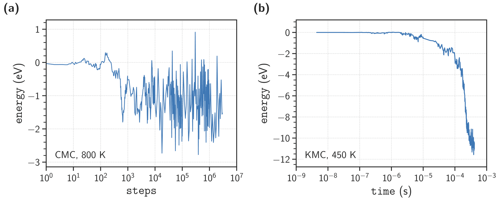
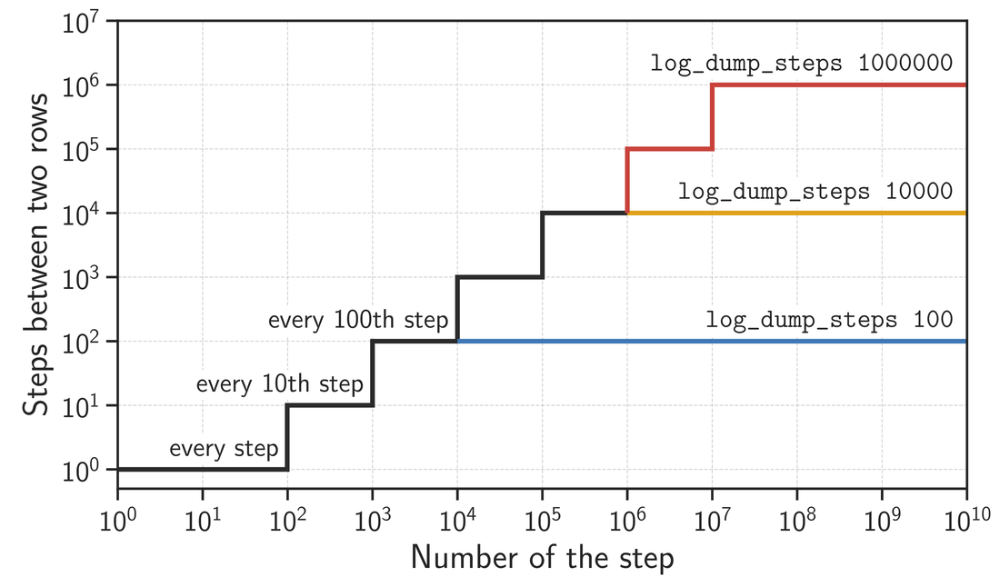

# Output files

All files are written to the directory the program is started in. The files of `Ansys` and `Reformat` are described in [Analysis](analysis.md).

| Method | Files |
|---|---|
| KMC | `kmc_log.txt`, `<step>.cfg.gz`, and `end.cfg.gz`, or `escaped.cfg.gz` instead if `early_stop` ended the run |
| CMC | `cmc_log.txt`, `<step>.cfg.gz`, `end.cfg.gz` |
| SA | `sa_log.txt`, `lowest_energy.cfg.gz` |

The standard output repeats the parameters of the run, among them the seed. Warnings and errors go to the standard error stream.

## Reading a log

A log is a text file with one header line. Tabs separate the columns, but the three components of a vector are separated by blanks, so a log has to be split at any white space. With pandas:

```python
import pandas as pd
log = pd.read_csv("kmc_log.txt", sep=r"\s+")
```

This plots the energy of a KMC run against the time:

```python
import matplotlib.pyplot as plt

log = log[log["time"] > 0]                  # no zero on a logarithmic axis
plt.semilogx(log["time"], log["energy"])
plt.xlabel("time (s)")
plt.ylabel("energy (eV)")
plt.savefig("kmc_energy.png", dpi=200)
```



*Column `energy` in the logs of the two runs of [A first run](README.md#a-first-run): (a) CMC at 800 K, (b) KMC at 450 K, which starts from the last configuration of (a). Both energies are relative to the start of the run. The row of step 0 does not show on a logarithmic axis.*

Every row describes the state of the box at the beginning of a step, before anything is moved.

## When a row is written

The interval between two rows grows with the number of steps: every step up to step 98, every 10th up to 998, every 100th up to 9998, and so on, until it reaches `log_dump_steps`, at the latest after step 10 × `log_dump_steps`. A row is written when the number of the step is a multiple of the interval. SA writes a row at every multiple of `log_dump_steps`, and one whenever it finds a new lowest energy, so a step can have two rows.



*Steps between two rows of a KMC or CMC log for three values of `log_dump_steps`. From step 99 on, the interval grows tenfold with every decade of steps, which gives about 90 rows per decade, until it reaches `log_dump_steps`. Where curves coincide, they are black.*

## kmc_log.txt

| Column | Unit | Meaning |
|---|---|---|
| `steps` | | Number of the step |
| `time` | s | Time at the beginning of the step. For the time in an alloy see [Methods](methods.md#time-and-vacancy-concentration) |
| `temperature` | K | Temperature of the step |
| `energy` | eV | Energy of the box relative to the start of the run: `restart_energy` plus the energy changes of all jumps so far |
| `Ea` | eV | Barrier of the jump that is made in this step |
| `dE` | eV | Energy change of this jump |
| `selected` | | Number of the atom that changes places with the vacancy in this jump: its place in the configuration files, counted from 0, the vacancy included |
| `vac1`, `vac2`, `vac3` | Å | Cartesian position of the vacancy before the jump, not wrapped back into the box |
| `solute_com1`, `solute_com2`, `solute_com3` | Å | Only with `solute_disp`: displacement of the center of mass of all solute atoms since the start of the run |

## cmc_log.txt

| Column | Unit | Meaning |
|---|---|---|
| `steps` | | Number of the step |
| `temperature` | K | Temperature of the run |
| `energy` | eV | Energy of the box relative to the start of the run: `restart_energy` plus the energy changes of all exchanges so far |
| `average_energy` | eV | Mean of `energy` over the last `thermodynamic_averaging_steps` steps, or over all steps so far if there are fewer. 0 if the key is 0 |
| `absolute_energy` | eV | Total energy of the box in the model |

## sa_log.txt

| Column | Unit | Meaning |
|---|---|---|
| `steps` | | Number of the step |
| `temperature` | K | Temperature of the step |
| `energy` | eV | Energy of the box relative to a solid solution of single solute atoms: its total energy, minus that of a box of pure solvent, minus the energy that each solute atom costs alone in pure solvent |
| `lowest_energy` | eV | Lowest value of `energy` so far |
| `absolute_energy` | eV | Total energy of the box in the model |

## Configurations

`<step>.cfg.gz` is written at every step that is a multiple of `config_dump_steps`, and `end.cfg.gz` at step `maximum_steps`. They hold the state at the beginning of the step, in the format of the [input configurations](input-files.md#configuration), with the counts of the boundary crossings. The order of the atoms is that of the start configuration.
