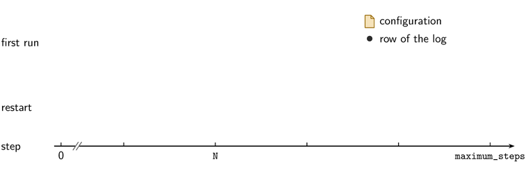

# Restarting and repeating a run

## Continuing a run

KMC and CMC runs can go on from any configuration they wrote. Pick a step `N` for which there is a file `N.cfg.gz` and a row in the log, and set in the parameter file:

| Key | Value |
|---|---|
| `config_filename` | `N.cfg.gz`. Remove `map_filename` if it is there: it would be used instead |
| `restart_steps` | `N` |
| `restart_energy` | `energy` of this row |
| `restart_time` | `time` of this row (KMC) |

*A KMC run that stopped, and its restart from step `N`, the last one with a configuration and a row in the log. The first rows of a run, which are closer together, are left out of the drawing. The rows that the first run wrote after step `N` turn pale when they are removed.*

Remove the rows after step `N` from the log before the run is started again: the new rows are added at the end of the file. The log has to be there, because a restart does not write the header line. The row of step `N` itself is not written a second time. `maximum_steps` still counts from step 0.

What a restart does not keep:

- The random numbers. The restarted run draws new ones, which follow from `seed` and `restart_steps`, so it does not repeat the steps the first run made after step `N`.
- The window of `average_energy` (CMC), which fills again from the beginning.
- The displacement of the solutes (`solute_disp`), which starts at 0 again.
- The site the vacancy came from (`KineticMcChainOmpi`).

SA cannot be restarted.

### restart.py

`script/restart.py` does this for a KMC run. It is started in the directory of the run, whose parameter file has to be called `kmc_param.txt`:

1. It moves `kmc_log.txt` to `kmc_log_backup.txt`, finds the last row with a configuration, and writes the log up to there to a new `kmc_log.txt`.
2. It moves `kmc_param.txt` to `kmc_param_backup.txt` and writes a new `kmc_param.txt` with the keys of the restart.

The old parameter file has to give `simulation_method`, `json_coefficients_filename`, `log_dump_steps`, `config_dump_steps`, `maximum_steps`, `thermodynamic_averaging_steps`, `element_set` and `early_stop`, with blanks, not tabs, between a key and its value. If one of them is missing, the script stops with a `KeyError` after it has moved both files. Rename the two backups back before you try again, or they are overwritten. `time_temperature_filename`, `solute_disp` and `seed` are kept if they are there; other keys are not. The new file gets the temperature of the last row.

## Repeating a run

Two runs with the same parameter file, input files, executable and numbers of processes and threads follow the same trajectory if the seed is the same. Without the key `seed` the program takes one from the clock and prints it at the start, so any run can be repeated by adding `seed <number>` to its parameter file.

`KineticMcFirstSerial`, `CanonicalMcSerial` and `SimulatedAnnealing` do not depend on the number of threads. `CanonicalMcOmp` does.
